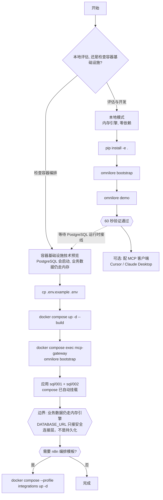

# OmniLore

**AI 原生可审计知识中枢** ｜ *One auditable knowledge base, for every agent.*

> ## `v0.3.0-alpha`
>
> **预发布版本（alpha）——仅供评估、研究与贡献使用，请勿放入任何重要业务流程。**
> 内部代际代号 v2.3，PEP 440 机读版本号 `0.3.0a0`。
> 许可：**[Apache-2.0](LICENSE)** ｜ 决策记录：**[docs/DECISIONS.md](docs/DECISIONS.md)**
> 仓库：**[github.com/KillerMan12345/OmniLore](https://github.com/KillerMan12345/OmniLore)**

OmniLore 是一个以**不可变原始证据（SHA-256 CAS Assets）**为基础、以**可审阅的 Obsidian Markdown 知识页**为人类主要编辑界面、并提供 PostgreSQL 15+（`pgvector` + `ltree`）DDL、参数化仓储层与真实 RLS 探针的知识中枢。**业务数据层当前仍是内存仿真引擎（`RLSDatabaseEngine`），进程退出后结构化状态清空 —— 不能据此宣称持久化或多人共享；设置 `DATABASE_URL` 时，MCP 会额外建立一条安全 PostgreSQL 连接层（连接角色必须非超级用户、无 `BYPASSRLS`、是策略角色成员，否则拒绝启动），并在事务内 `SET LOCAL ROLE` + 注入 RLS GUC —— 但业务读写**尚未**走这条连接。**

> **首屏这句话里的每一条能力，都有证据状态**（不是裸宣称）：
> **不可变原始证据（SHA-256 CAS）= `Implemented`** ｜
> **行级安全策略（RLS）策略挂载与跨空间读拦截 = `Tested-real`**
> （CI 的 `integration-rls` job 每次 push 都在真实 PostgreSQL 16 上重跑这 3 条探针，
> 自 2026-10-26 起已**连续 2 次绿灯**；**这不等于业务运行时已接入 PostgreSQL，也不等于数据已持久化**）｜
> **四维权限交集 / Profile 隔离 = `Simulated`**（探针只覆盖 space + category 两维，
> profile / membership / 组织树继承**未被验证**）｜
> **混合检索（BM25 + 向量 + 代码符号）= `Simulated`**
> —— 其中 `hybrid` 路径在 CI 里是 monkeypatch 桩，**没有任何一次真实网络调用** ｜
> **PostgreSQL 安全连接层与 RLS 生效验证 = `Tested-real`**（2026-10-25 / 2026-10-26 在真实 PostgreSQL
> 16.15 上以应用角色 `omnilore_app` 人工跑通三条探针，**非 CI**、一次性，可复跑脚本
> `tools/verify_rls_app_role.py`；它只证明「安全连接这条路径上 RLS 确实生效」，
> **不证明业务数据已持久化到 PostgreSQL**）
> 完整 32 条标注见 [`docs/FEATURE_STATUS.md`](docs/FEATURE_STATUS.md)（真实 PG 证据记录见其第 6 / 6.1 节）。

核心价值不是「把文件塞进向量库」，而是把分散资料变成**有来源、有状态、有版本、有权限、有纠错路径**的资产。

---

## 先说清楚：我们会往你的笔记里写字段（你可以关掉）

OmniLore 为了做到「每条回答都能追溯到原始证据」，会在你的 Obsidian 知识页的
YAML frontmatter 里写入 **9 个系统字段**（`doc_id`、`space_id`、`series_id`、
`version_key`、`version_label`、`source_asset_ids`、`source_task_id`、
`content_revision`、`review_status`）。

**我们不藏着这件事，也不打算替你保管主权：**

- 其中 `space_id` / `series_id` / `version_key` / `version_label` 默认**受保护**（你在 Obsidian 里改它们会被拒绝）——
  这是防止文本编辑意外改写归属关系；
- 受保护字段**可以自己配置**，也可以**整体关闭**：`OMNILORE_PROTECTED_FRONTMATTER=none`
  （详见 [`.env.example`](.env.example)）。关掉之后，改这些字段不再被拦，代价是你自己承担归属一致性；
- 唯一不可关闭的是 `doc_id`：它是同步时定位文档的身份锚点，放开等于让文本编辑改写身份；
- 并发冲突时生成的 `.conflict_r*.md` 副本**不再散落在你的 vault 里**，统一落到隐藏目录
  `.omnilore/conflicts/`（点号开头 = **Obsidian 默认忽略**；注意 Windows 资源管理器
  **仍然可见**，NTFS 不因点号隐藏目录），可用 `OMNILORE_CONFLICT_DIR` 改。

**预先声明本身就是差异化**：我们宁可把这句话写在首屏，也不愿你在不知情的情况下发现它。

> 上面两条能力的证据状态：**受保护字段白名单可配 = `Implemented`** ｜
> **冲突副本落隐藏目录 = `Implemented`**（见下方核心能力与状态矩阵）。
>
> ⚠️ **这两个开关只在进程环境变量里生效 —— 我们不读 `.env`**（全仓没有 dotenv 依赖）。
> 本地模式请用 `export OMNILORE_PROTECTED_FRONTMATTER=...`；容器模式的转发已内置在
> `docker-compose.yml`。每次 `omnilore bootstrap` 都会回显**当前实际生效**的值，
> 变量名拼错时也会被点名 —— 静默失效比失败更糟。

---

## 60 秒验证（零 API Key，三段命令 + 可选的证据包）

**不需要任何云账号、不需要配置 API Key、不需要数据库。** 三条命令跑完，你就拥有了一个可用的知识库。

### 第 1 步：安装

```bash
git clone https://github.com/KillerMan12345/OmniLore.git && cd OmniLore

python -m venv .venv && source .venv/bin/activate   # Windows: .venv\Scripts\activate
pip install -e .                                    # 若无本地 Python 环境管理器，pip install -e . 亦可
```

> 已在本仓库目录下可跳过 clone，直接 `pip install -e .`。

### 第 2 步：引导（`bootstrap` —— 创建空间与 token）

```bash
omnilore bootstrap
```

预期输出（节选，token 每次随机）：

```text
====================================================================
OmniLore bootstrap 完成
====================================================================
  数据目录      : /home/you/OmniLore_Data
  默认空间      : sp_bootstrap_personal
  Owner user_id : 00000000-0000-4000-8000-000000000001
  检索模式      : keyword_only
  降级说明      : 未配置 DASHSCOPE_API_KEY，向量召回不可用，已自动降级为本地 BM25 / 关键词（keyword_only）检索

  Owner Token   : tok__UVvbCICPCl0YUXeblmqr7wFDwYDZfJdNmHDH01hOB0  （新签发）
  Token 已持久化: /home/you/OmniLore_Data/ops/bootstrap.json
                  请妥善保存该 token；MCP 客户端首参即为该 token。
```

### 第 3 步：投一份文档，再把它搜出来（`demo`）

```bash
omnilore demo
```

预期输出（节选）：

```text
====================================================================
OmniLore demo：投一份文档，再搜到它（零 API Key）
====================================================================
  数据目录  : /home/you/OmniLore_Data
  目标空间  : sp_bootstrap_personal
  检索模式  : keyword_only
  降级说明  : 未配置 DASHSCOPE_API_KEY，向量召回不可用，已自动降级为本地 BM25 / 关键词（keyword_only）检索

[1/3] 收录文档：omnilore_welcome_note.md
      任务状态      : COMMITTED
      结果文档 ID   : be62e0e5-cba1-4112-8427-89f43eea2b34
[2/3] 检索关键词：'60 秒验证清单'
      命中结果数    : 1
      retrieval_mode: keyword_only
      degraded_reason: 未配置 DASHSCOPE_API_KEY，向量召回不可用，已自动降级为本地 BM25 / 关键词（keyword_only）检索

      #1 score=1.0  《OmniLore 零密钥上手说明》 v1.0
          # OmniLore 零密钥上手说明 ## 核心摘要 # OmniLore 零密钥上手说明 OmniLore 是一个 AI 原生的可审计知识中枢。本次演示在**没有任何云 API Key**的情况下完成 收录与检索，说明：不配置 `DASH

[3/3] 结论
      ✅ 已成功检索到刚收录的文档 be62e0e5-cba1-4112-8427-89f43eea2b34，60 秒验证通过。

  提示：Obsidian 知识页位于 /home/you/OmniLore_Data/02_Vault/spaces/sp_bootstrap_personal/wiki
```

### 想带走证据？（`audit-bundle`）

```bash
omnilore audit-bundle            # 导出到 <数据目录>/ops/audit_bundles/
```

得到 `audit-bundle.json` + `audit-bundle.verify.md`：文档信息、每个原始证据的 SHA-256、
版本链，以及「这个哈希该拿哪个文件、用 `sha256sum` / `certutil` 怎么重算、与哪个字段比对」。
导出时会**从磁盘字节重算哈希**再做比对 —— 内容被改过就报 `mismatch` 并以退出码 3 结束，
不会给你一个「看起来正常」的包。
（证据口径：**`Tested-real`** —— `make verify-audit` 与 4 条跨进程用例实测，详见
[`docs/FEATURE_STATUS.md`](docs/FEATURE_STATUS.md)）

> 上面两段是**程序真实输出的抄录**，只有 3 处按运行环境替换：数据目录路径（此处写作
> `/home/you/OmniLore_Data`）、随机生成的 token、随机生成的 doc_id。其余每一行逐字一致。

**看到 `✅` 就说明一切正常。** 全部过程没有联网、没有 Key。

> CLI 两种调用方式等价：`omnilore bootstrap` 与 `python -m omnilore bootstrap`。

---

## 我该走哪条路？（本地模式 vs 容器基础设施技术预览）



纯文本版：

```text
本地模式（推荐先试）
  pip install -e .  ->  omnilore bootstrap  ->  omnilore demo
  数据: ./OmniLore_Data    引擎: 内存 RLSDatabaseEngine    外部依赖: 无
  代价: 进程重启后结构化状态清空（已收录的文件与知识页仍在磁盘上）

容器基础设施技术预览（**不是持久化运行模式**）
  cp .env.example .env  ->  docker compose up -d --build  ->  容器内 omnilore bootstrap
  基础设施: PostgreSQL 16 + pgvector + 已应用的 SQL    应用引擎: 仍为内存 RLSDatabaseEngine
  已具备: 设置 `DATABASE_URL` 时，MCP 会建立安全 PG 连接层 —— 强制连接角色非超级用户、
          无 `BYPASSRLS`、是策略角色成员（否则拒绝启动），事务内 `SET LOCAL ROLE` + 注入 RLS GUC，
          且「RLS 在这条连接上确实生效」已在真实 PostgreSQL 16.15 上以应用角色人工验证过
          （2026-10-25 / 2026-10-26 两套独立环境，均**非 CI**）
  边界: 这条连接只做安全接入与启动自检，**尚未**承载业务读写；`AsyncpgRepository` 仍未被业务路径
        实例化，结构化状态仍随进程结束而清空
  可选: docker compose --profile integrations up -d   # n8n 模板编排；尚未在真实 n8n 实例导入验证
```

| 维度 | 本地模式 | 容器基础设施技术预览 |
|---|---|---|
| 首启耗时 | 秒级 | 分钟级（需拉镜像） |
| 外部服务 | 无 | Docker + PostgreSQL（数据库会启动） |
| 业务运行时 | 内存 `RLSDatabaseEngine` | **仍为内存 `RLSDatabaseEngine`**；设置 `DATABASE_URL` 时多一条**安全 PG 连接层**（安全角色 + 事务内 `SET LOCAL ROLE` + RLS GUC），它**不是**业务数据路径，PostgreSQL 仓储层**尚未**接入业务读写 |
| 结构化数据持久化 | 否（进程生命周期） | **否**；当前只有 PostgreSQL DDL / seed / 独立探针与安全连接自检，不能当作业务持久化证据 |
| RLS 策略执行方式 | 同构内存模拟（`Simulated`） | 应用请求仍为同构内存模拟（`Simulated`）；SQL 策略另有两条 `Tested-real` 证据：**策略角色直连的 3 条探针已由 CI 的 `integration-rls` job 持续验证**（自 2026-10-26 起连续 2 次绿灯），**应用角色走运行时连接层的 3 条探针仍是人工一次性、非 CI**；两者都**不等于业务运行时已接入 PG / 数据已持久化** |
| 适用 | 评估、开发、离线验证 | 检查镜像、SQL 初始化与可选集成模板；**不适合宣称长期持有或多人共享** |

---

## 降级与上报（重要）

OmniLore **不会因为缺少云 API Key、或者 Key 配错了而拒绝工作**。

`search_knowledge` 的返回值里，**检索**与**答案合成**是两个正交维度，各自独立上报：

| 字段 | 含义 |
|---|---|
| `retrieval_mode` | `hybrid`（向量+关键词；该路径当前为 `Simulated`，无真实依赖证据）或 `keyword_only`（纯 BM25 / 关键词；真实执行） |
| `degraded_reason` | **仅**描述检索是否降级；检索正常时为空串 |
| `synthesis_degraded` | 答案合成是否回退到本地确定性逻辑 |
| `synthesis_note` | 合成回退的原因；正常时为空串 |

之所以拆成两组字段：曾经把合成失败并进 `degraded_reason`，会出现
`retrieval_mode=hybrid` 却 `degraded_reason` 非空的**自相矛盾**组合，调用方没法再用
「`degraded_reason` 是否为空」判断检索能力。拆开后两个维度正交（`hybrid` 那条路径的
证据边界见下方注释：它目前是 `Simulated`，不是 `Tested-real`）。

四种组合态：

| # | 场景 | `retrieval_mode` | `degraded_reason` | `synthesis_degraded` | 说明 |
|---|---|---|---|---|---|
| 1 | 未配置 `DASHSCOPE_API_KEY`（**默认**） | `keyword_only` | 非空 | `false` | 纯 BM25 / 关键词（CJK 二元组分词）；答案由本地确定性逻辑生成，这是**设计路径，不是故障** |
| 2 | 已配置且完全可用 | `hybrid` | 空串 | `false` | BM25 + 1024 维向量 + 代码符号混合检索（**`Simulated`**：无真实依赖证据，见下方说明） |
| 3 | 已配置但向量召回不可用（过期 / 额度耗尽 / 断网） | `keyword_only` | 非空 | 视合成是否也失败 | 本次请求降级为关键词，**不抛异常**（`keyword_only` 路径为 `Tested-real`） |
| 4 | 向量召回正常、答案合成失败 | `hybrid` | **空串** | `true` | 检索能力未受损，只有合成回退；原因见 `synthesis_note`（`hybrid` 路径为 `Simulated`，见下方说明） |

> ⚠️ **组合态 2 与 4（`hybrid`）目前没有真实依赖证据。** CI 里验证 `hybrid` 的用例用的是
> monkeypatch 桩（`DashScopeHTTPTransport.post_json` 被替换、Key 是占位串），
> **没有任何一次真实网络调用或真实 1024 维向量**；所以「混合检索」在状态矩阵里标
> **`Simulated`**，不是 `Tested-real`。组合态 1 / 3（`keyword_only`）才是真实执行的路径
> （**`Tested-real`**）。配了 Key 的用户请自己跑一遍 `make verify-search` 并核对结果。

`DASHSCOPE_API_KEY` 是**完完全全的可选项**。降级与否一律如实上报，
**不会**把故障伪装成正常，也**不会**把内部 bug 伪装成供应商故障（后者会记 stderr）。

> 分词说明：本地关键词检索的分词策略与本地确定性嵌入保持一致（词串 + 滑动 CJK 二元组）。
> 若只做整词匹配，中文查询几乎无法命中，因此这里刻意采用二元组。

---

## 仓库目录结构

```text
omnilore/
├── LICENSE                                           # Apache-2.0 完整原文
├── NOTICE                                            # 归属、依赖与商标政策
├── CHANGELOG.md                                      # 变更日志
├── CONTRIBUTING.md                                   # 贡献指南（DCO + 六条贡献路径）
├── Makefile                                          # 可复跑的验证入口（make verify-rls 等）
├── SECURITY.md                                       # 漏洞披露政策（Issue/PR 首响 ≤48h）
├── CODE_OF_CONDUCT.md                                # Contributor Covenant 风格行为准则
├── README.md                                         # 本文件
├── pyproject.toml                                    # 包配置与 CLI 入口（version = 0.3.0a0）
├── Dockerfile                                        # 容器镜像构建文件
├── docker-compose.yml                                # postgres + mcp-gateway（n8n 为可选 profile）
├── .env.example                                      # 环境变量模板（标注必填/可选）
├── .gitignore
├── .github/
│   ├── PULL_REQUEST_TEMPLATE.md                      # 含 DCO 勾选项
│   ├── ISSUE_TEMPLATE/                               # 6 套表单，以单选下拉为主（可统计）
│   └── workflows/
│       ├── ci.yml                                    # CI：离线矩阵（3.11/3.12 × ubuntu/windows）+ integration-rls（真实 PG）
│       └── triage.yml                                # 选项 → 标签自动分流（P0-escape / security-triage）
├── docs/
│   ├── FEATURE_STATUS.md                             # 能力状态矩阵（四态标注 + 验证命令）
│   ├── ROADMAP_STATUS.md                             # 8 周首发窗口的公开任务进度与门禁
│   ├── THREAT_MODEL.md                               # 威胁模型：信任边界 / 能防 / 防不住
│   ├── DECISIONS.md                                  # 六项拍板决策（含多存储后端冻结决定）
│   ├── OmniLore_PRD_Architecture_Final_v2.3.md      # PRD 与架构决策基线母本
│   ├── 01_Product_Requirements_Document_v2.3.md      # PRD 摘要版（FR-01~FR-19 + D-01~D-13）
│   ├── 02_Architecture_and_Engineering_Design_v2.3.md
│   ├── 03_User_Stories_and_Scenarios_v2.3.md
│   └── 04_Test_Plan_and_Verification_Report_v2.3.md
├── n8n/workflows/                                    # 3 条可导入工作流 JSON 模板（仅结构可解析；真实 n8n 导入未验证）
├── sql/
│   ├── 001_omnilore_schema_and_rls.sql              # 15 张表 + 角色 + RLS（仅 DDL）
│   └── 002_omnilore_bootstrap_seed.sql              # 新增：最小 space/成员/token 种子数据
├── omnilore/                                        # 核心 Python 源码包
│   ├── __init__.py                                   # 公共导出 + __version__
│   ├── cli.py                                        # omnilore CLI（bootstrap/demo/audit-bundle/version）
│   ├── __main__.py                                   # 新增：python -m omnilore
│   ├── bootstrap.py                                  # 新增：零密钥引导（CLI 与 MCP 共用）
│   ├── textio.py                                     # 新增：跨平台规范 LF 文本 I/O
│   ├── engine.py                                     # 核心引擎（约 3200 行，贡献请看 CONTRIBUTING）
│   ├── pg_repository.py                              # asyncpg 参数化 SQL 仓储层（尚未接入 CLI / MCP 业务数据路径）
│   ├── pg_runtime.py                                 # 安全 PG 运行时连接层：强制安全角色 + 事务内 SET LOCAL ROLE + RLS GUC
│   ├── dashscope_client.py                           # 百炼 HTTP 适配层 + 模型配置（读 OMNILORE_* 环境变量）
│   ├── embedding_provider.py                         # **R-04b** 向量来源抽象（dashscope / openai 兼容 / none）
│   ├── runtime_index.py                              # **R-05m** 运行时索引（audit-bundle 跨进程的派生物）
│   ├── parsers.py                                    # 多格式解析器（纯函数，好入手）
│   ├── ops_manager.py                                # 备份/恢复/索引重建/一致性对账
│   ├── daemons.py                                    # Outbox 恢复与 Obsidian 监听守护
│   ├── http_worker_api.py                            # 供 n8n 调用的内部 HTTP 网关
│   └── mcp_stdio_server.py                           # FastMCP JSON-RPC 2.0 Stdio 服务端
├── tools/
│   ├── verify_rls_pg.py                              # 真实 PostgreSQL RLS 探针（缺环境即「未验证」）
│   ├── verify_rls_app_role.py                        # 用**应用角色**在真实 PG 上复现 RLS 三条（需真实 PG + 应用角色）
│   └── verify_audit_bundle.py                        # 证据包探针：改 1 字节必须 mismatch + exit 3
└── tests/                                            # 端到端验收测试，共 168 个用例（0 skip）
    ├── _platform_support.py                          # 新增：宿主能力探测（symlink → junction 回退）
    ├── test_omnilore_phase0_acceptance.py           # Phase 0/1 专项（安全/RLS/幂等/恢复/模型门禁）10 项
    ├── test_full_omnilore_suite.py                  # Phase 0~3 + Ops 综合验收 9 项
    ├── test_w0_launch.py                             # W0 新增回归（引导/LF/版本/降级/合成正交/归因/权限/漂移/CLI/MCP 入口/文档宣称）37 项
    ├── test_w2_w3_roadmap.py                        # W2/W3 新增（P2 主权/诚实标注/贡献入口）+ W4（R-08b 真实 PG 集成 CI 配置守卫）+ R-05m（证据包导出）/ R-08b 补课（21 条策略注释）+ 跨进程导出 + 真实 PG 例外证据性质守卫 61 项
    ├── test_w6_provider_and_platform.py             # W6 新增：R-04b 向量来源抽象 / 四个环境变量真的生效 / 维度守卫 / 降级回归；R-11b 统一数据目录 + arm64 CI 守卫 30 项
    ├── test_pg_runtime_wiring.py                    # PG 运行时接线：内存引擎默认 + 拒绝超用户/BYPASSRLS 连接角色 5 项
    ├── test_context_budget.py                       # 理念一：Token 预算治理、分段折叠与按需下钻 5 项
    ├── test_citation_grounding.py                   # 理念二：防幻觉强制引用校验（Citation Grounding）4 项
    ├── test_tiered_mcp_tooling.py                   # 理念四：MCP 工具能力分层治理（Query/Governance）2 项
    ├── test_storage_contract.py                     # 理念五：最小存储后端契约与适配层 2 项
    └── test_evolution_chain.py                      # 理念三：知识因果演化链与 MRP 变更提议 3 项
```

---

## 跑测试

```bash
python -m unittest discover -s tests -p "test_*.py" -v
# 等价：make verify
```

**168 个测试用例**，全部离线运行，不需要数据库或 API Key：

| 测试文件 | 数量 | 覆盖 |
|---|---|---|
| `test_omnilore_phase0_acceptance.py` | 10 项 | Phase 0/1 专项：安全、RLS（跑在内存仿真引擎上，`Simulated`）、幂等、崩溃恢复、模型门禁 |
| `test_full_omnilore_suite.py` | 9 项 | Phase 0~3 + Ops 综合验收 |
| `test_w0_launch.py` | 37 项 | **W0 新增**：引导幂等与 token 复用、LF 规范化、版本号一致、零 Key 降级、供应商故障降级、CLI/MCP 路径解析一致、CLI 端到端、MCP stdio 入口握手、`OMNILORE_AUTO_BOOTSTRAP=0` 不废既有 token |
| `test_w2_w3_roadmap.py` | 61 项 | 主权配置、诚实标注、贡献入口、真实 PG 集成 CI 配置守卫（该 job 已真实运行、连续 2 次绿灯，故标 `Tested-real`）、证据包字段与篡改、21 条 RLS 策略注释、4 条跨进程导出、两条真实 PG 例外的证据性质守卫 |
| `test_w6_provider_and_platform.py` | 30 项 | provider 抽象、四个环境变量真实生效、维度守卫、降级回归、统一数据目录、arm64 CI 配置守卫 |
| `test_pg_runtime_wiring.py` | 5 项 | PG 运行时接线（`Implemented`，离线 mock 钉住；真实 PG 证据见 `tools/verify_rls_app_role.py`）：默认内存引擎、无 DATABASE_URL 不接 PG、拒绝超用户/BYPASSRLS 连接角色 |
| `test_context_budget.py` | 5 项 | 检索 Token 预算治理、均分裁剪、代码折叠与按需下钻（Implemented，离线验证） |
| `test_citation_grounding.py` | 4 项 | 事实指纹匹配、防幻觉引用检验、未证实声明拦截（Implemented，离线验证） |
| `test_tiered_mcp_tooling.py` | 2 项 | MCP 分层元数据规范（Query 消费面 vs Governance 治理面）与筛选（Implemented，离线验证） |
| `test_storage_contract.py` | 2 项 | 统一 StorageBackend Protocol 契约与引擎适配层（Implemented，离线验证） |
| `test_evolution_chain.py` | 3 项 | CausalEvolutionDAG 因果指针跟踪与 MRP 知识变更提议检查（Implemented，离线验证） |

> ⚠️ **这 168 个测试全部离线运行：业务用例跑在 `omnilore.engine.RLSDatabaseEngine`（内存仿真引擎）上；新增的 `test_pg_runtime_wiring.py` 用 mock 钉住 PG 运行时接线，不连真实 PG。**
> 它与 PostgreSQL RLS **同构**，但**不是真实 PostgreSQL** —— 所以它们证明的是**逻辑正确性**，
> 不等于「真实 PG 上的 RLS 已验证」。真实 PG 的 RLS 相关能力一律标注 `Simulated` ——
> **两条例外**（都在真实 PostgreSQL 16.15 上取过证，但**证据性质不同**）：
> ①「真实 PostgreSQL RLS 策略与跨空间读拦截」—— 2026-10-24 人工 3 探针 PASS，且自 2026-10-26 起
> 由 `.github/workflows/ci.yml` 的 `integration-rls` job 每次 push 在真实 PostgreSQL 16 上重跑
> 同三条探针，**已连续 2 次绿灯**（持续 CI 证据）；②「PostgreSQL 安全连接层与 RLS 生效验证」——
> 2026-10-25 / 2026-10-26 以应用角色 `omnilore_app` 走运行时连接层，**人工一次性、非 CI**，
> 3 探针 PASS —— **它不证明业务数据已持久化**，业务读写仍走内存引擎。
> **① 的边界（必须一并读）**：CI 绿灯证明的是 `sql/001` 的 **SQL 策略本身**在真实 PG 上生效，
> **不等于 CLI / MCP 业务运行时已接入 PostgreSQL**，也**不等于**结构化状态已持久化。
> 详见 [`docs/FEATURE_STATUS.md`](docs/FEATURE_STATUS.md) 第 6 / 6.1 节。
> **我们公开边界，因为我们做安全。**

### 支持架构

OmniLore 支持 **x86_64 与 arm64** 两种 CPU 架构，验证方式不同，如实写在这里：

| 架构 | 状态 | 验证方式 |
|---|---|---|
| `x86_64`（Linux / Windows；macOS Intel 为兼容目标） | `Tested-real`（Linux / Windows） | CI 离线矩阵为 `ubuntu-latest` × `windows-latest` × Python 3.11/3.12；当前没有 macOS job，**不得把 macOS 写成已验证** |
| `arm64`（Apple Silicon / AWS Graviton / 树莓派 4+） | `Tested-real` | `.github/workflows/ci.yml` 的 **`arm64`** job（`ubuntu-24.04-arm`，GitHub 公共仓库免费 runner）跑**同一套 168 个离线用例** + `ruff` + bootstrap/demo 冒烟。**已 3 次绿灯**（Run #2 `5d513fe`、#4 `cb45932`、#5 `effbb02`，其中 #4/#5 连续），达到「连续 ≥2 次绿灯」的升级门槛，故标 `Tested-real`。边界：仅覆盖离线套件 + `ruff` + 零密钥冒烟，不覆盖真实 PG 业务数据面 |

> 为什么 arm64 单独一个 job 而不是并进矩阵：`integration-rls` 刻意留在 x86（真实 PostgreSQL
> service container）。在 arm64 上同时引入「新架构 + 新服务容器」两个变量，一旦红了分不清是谁的锅。

### 自己复跑验证

每条能力标注该用什么命令验证，都写在 [`docs/FEATURE_STATUS.md`](docs/FEATURE_STATUS.md) 里：

```bash
make verify            # 全量（离线）
make verify-rls        # 权限/RLS/版本/同步（内存仿真引擎 —— 只证明逻辑）
make verify-sync       # Obsidian 同步：受保护字段可配 + 冲突副本隐藏目录
make verify-honesty    # 诚实标注守卫：三处一致
make verify-audit      # 证据包：改 CAS 里 1 个字节 → mismatch + 退出码 3
make verify-rls-pg     # 真实 PostgreSQL 探针（需要 psql + DATABASE_URL，缺环境即报「未验证」）
python tools/verify_rls_app_role.py   # 用**应用角色**在真实 PG 上复现 RLS 三条（需要真实 PG + 应用角色）
```

> **关于符号链接断言（已做到 0 skip）**：AC-S05 需要构造一个指向 Vault 之外的链接，
> 但很多 Windows 环境没有创建符号链接的特权。我们按能力**逐级回退**：
> ① 真实 **symlink**（Linux / macOS / 开了开发者模式的 Windows）；
> ② **目录联接 junction**（`mklink /J`，Windows 上**无需特权**）——它不是 symlink，
> 但 `Path.resolve()` 会穿透它，因此仍会被 `SecureVaultStorage._verify_safe_subpath`
> 的「越出根目录边界」检查拦下，是真实验证而非桩；
> ③ 两者都造不出来时才 **skip**，并给出可复核的原因（宿主能力限制，非平台缺陷）。
>
> 当前已确认的证据来自 Linux / Windows；本次 Windows 宿主通过 junction 回退做到 **0 skip**。
> 当前 CI 没有 macOS runner，因此 macOS 只作为兼容目标，**不宣称已经实跑**。我们刻意不使用静默 `try/except` 去掩盖 ——
> 详见 `tests/_platform_support.py`。

---

## 核心能力（四态标注 —— 无一条裸宣称）

> **状态口径**：下面每一条能力都带四态标注，逐条对应
> [`docs/FEATURE_STATUS.md`](docs/FEATURE_STATUS.md)，并由自动化测试守护「README 与矩阵一致」。
>
> | 状态 | 含义 |
> |---|---|
> | `Implemented` | 代码已实现，仓库内有自动化用例覆盖（跑在进程内内存引擎上） |
> | `Tested-real` | CI 里存在**真实外部依赖**上的证据：真实子进程、真实跨平台文件系统、真实第三方解析库 |
> | `Simulated` | 只在与 PostgreSQL RLS **同构的内存仿真引擎**上验证；真实 PostgreSQL **没有 CI 证据** |
> | `Tested-real`（真实 PG 例外） | 真实 PostgreSQL 16.15 上的三条探针（策略挂载 / 跨空间不可见 / 授权后可见），**证据性质分两种**：①「真实 PostgreSQL RLS 策略与跨空间读拦截」由 CI 的 `integration-rls` job **持续验证**（自 2026-10-26 起连续 2 次绿灯）；②「PostgreSQL 安全连接层与 RLS 生效验证」仍是 2026-10-25 / 2026-10-26 的**人工一次性**验证（非 CI）。两者都**不等于业务运行时已接入 PG / 数据已持久化**，见 [`docs/FEATURE_STATUS.md`](docs/FEATURE_STATUS.md) 第 6 / 6.1 节 |
> | `Planned` | 尚未实现，或仅有模板、未经过自动化验证 |
>
> **当前统计（三处一致，由测试守护）：**
> `Implemented` 9 条 ｜ `Tested-real` 10 条 ｜ `Simulated` 12 条 ｜ `Planned` 1 条 —— 合计 **32 条**。
>
> **测试跑在什么上面（重要）**：本项目的绝大多数业务用例都跑在
> `omnilore.engine.RLSDatabaseEngine`（**内存仿真引擎**）上 —— 它与 PostgreSQL RLS
> 策略同构，但**不是真实 PostgreSQL**；5 个 PG 运行时接线用例同样是**离线 mock**，
> 不连真实 PG；另有少数几条守卫只做静态文本/配置判定、不碰引擎。因此凡是依赖真实 PG 的能力，一律标注
> `Simulated`，并在 [`docs/FEATURE_STATUS.md`](docs/FEATURE_STATUS.md) 里给出
> **你可以自己复跑的验证命令**。
> **两条例外**（都在真实 PG 16.15 上取过证，但**证据性质不同**）：
> ①「真实 PostgreSQL RLS 策略与跨空间读拦截」—— 2026-10-24 人工 3 探针 PASS，且自 2026-10-26 起
> 由 CI 的 `integration-rls` job 每次 push 重跑同三条探针，**已连续 2 次绿灯**（持续 CI 证据）；
> ②「PostgreSQL 安全连接层与 RLS 生效验证」—— 2026-10-25 / 2026-10-26 以应用角色走运行时连接层，
> **人工一次性、非 CI**，3 探针 PASS —— **② 不证明业务数据已持久化**，业务读写仍走内存引擎。
> **① 的边界**：CI 绿灯只证明 `sql/001` 的 SQL 策略在真实 PG 上生效，**不等于业务运行时已接入
> PostgreSQL**，也**不等于**结构化状态已持久化。信任边界与「防不住什么」见
> [`docs/THREAT_MODEL.md`](docs/THREAT_MODEL.md)。
>
> **我们公开边界，因为我们做安全。**

### Phase 0 — 安全基座

- **[Tested-real]** **真实 PostgreSQL RLS 策略与跨空间读拦截**：2026-10-24 在真实 PostgreSQL 16.15 上跑 `make verify-rls-pg`，三条探针全部 PASS（7 张核心表 `rowsecurity=true`；未授权时跨空间行不可见；授权后同一行可见）。**现已由 CI 持续验证**：`.github/workflows/ci.yml` 的 `integration-rls` job 每次 push 都在干净的真实 PostgreSQL 16 上重跑这三条探针，自 2026-10-26 起**已连续 2 次绿灯**。**边界（必须一并读）**：它证明的是 `sql/001` 的 **SQL 策略本身**在真实 PG 上生效，**不等于 CLI / MCP 业务运行时已接入 PostgreSQL，也不等于数据已持久化** —— 业务读写仍走内存引擎。
- **[Simulated]** **四维权限交集**：每次请求强制计算 `Token 范围 ∩ 当前有效 Membership ∩ 空间继承规则 ∩ Profile/Category 规则`。
- **[Simulated]** **Profile 硬性隔离**：`WORK` Profile 硬性隔离同一空间下的 `02_Life` / `03_Family` / `04_Health_Archive`；`FAMILY` Profile 硬性隔离个人私库与企业空间。
- **[Simulated]** **撤销即时失效**：Token 撤销与成员移除立即触发进程内缓存主动失效（实测 `< 1ms`，满足 `≤ 5s` SLO）。
- **[Tested-real]** **文件网关路径防御**：拒绝绝对路径、`..`/`.` 段与符号链接；只接受受控的 `space_id/wiki/...` 相对路径。

### 基础

- **[Implemented]** **不可变原始证据（SHA-256 CAS）**：原始字节按 SHA-256 内容寻址落盘，恢复与对账逐文件校验哈希；**不做**原地改写（不可变性由写入路径保证，暂无专门的负向测试）。

### Phase 1 — 入库、版本、检索

- **[Implemented]** **多格式入库**：Markdown、代码、PDF（实现使用 `pdfplumber` / `pypdf` 提取页码与表格）、图像（自动化用例真实调用 `Pillow`）。**PDF 分支当前没有自动化用例，也没有真实 PDF 样本证据**，因此整体不标 `Tested-real`。
- **[Simulated]** **混合检索（BM25 + 向量 + 代码符号）**：`keyword_only` 路径真实执行；**`hybrid`（1024 维向量）路径在 CI 里是 monkeypatch 桩，没有真实网络调用**，故整体标 `Simulated`。
- **[Implemented]** **AST 代码符号提取**：类名、方法名、REST 路由、`ADR-xxx`，支持按 `code_symbol` 过滤。
- **[Simulated]** **两阶段零停机版本控制**：新建 / `REPLACE_VERSION` / `SUPPLEMENT_DOC` / `REVERT_VERSION`。
- **[Simulated]** **七类审核动作**：`APPROVE_REVIEW`、`RECLASSIFY`、`SPLIT_DOCUMENT`、`FIX_EXTRACTED_FIELD`、`REVERT_VERSION`、`PROMOTE_COPY`（含脱敏预览）、`CANCEL_TASK`。
- **[Simulated]** **Obsidian 双向同步**：写回哈希比对防死循环、受保护 Frontmatter 字段防篡改、冲突副本、自动生成 `_dashboard_控制台.md`。
- **[Implemented]** **受保护字段白名单可配**：`OMNILORE_PROTECTED_FRONTMATTER` 可增删受保护系统字段，`none` 整体关闭 —— 你的笔记你做主（见首屏声明）。
- **[Implemented]** **冲突副本落隐藏目录**：`.conflict_r*.md` 不再散落 vault，落到 `.omnilore/conflicts/`，可用 `OMNILORE_CONFLICT_DIR` 改。

### Phase 2 — 家庭与健康

- **[Simulated]** **家庭成员管理**：家庭空间 `ADMIN` 邀请 / 更新 / 撤销成员。
- **[Simulated]** **健康指标提取与人工核验**：体检指标自动提取并默认标记 `NEEDS_CHECK`（附「AI 提取，尚未核验」提示），经人工 `FIX_EXTRACTED_FIELD` 复核后转为 `HUMAN_VERIFIED`。
- **[Simulated]** **知识巡检 lint**：`run_knowledge_lint` 巡检过期 TTL、悬空 `[[双链]]` 与未核验指标 —— 只出建议，不静默改写。

### Phase 3 — 企业组织树

- **[Simulated]** **组织树只读继承**：沿 `parent_space_id` 与 `ltree`（`org.eng.backend` → `org.eng` → `org`）自动继承上级 `ORG_PUBLIC` 空间**只读**权限；写权限绝不继承，`ORG_RESTRICTED` 不参与继承。
- **[Implemented]** **跨空间晋升脱敏**：跨空间晋升时自动扫描并脱敏身份证号、手机号、银行卡号与 `sk-`/`tok-`/`ak-` 密钥。

### Section 12 — 运维

- **[Simulated]** **备份恢复与一致性对账**：SHA-256 manifest 快照备份、恢复前逐文件校验、跨版本蓝绿向量索引重建、磁盘与数据库一致性对账（`reconcile_consistency`）。
- **[Tested-real]** **审计证据包导出（audit-bundle）**：`omnilore audit-bundle` 导出 `audit-bundle.json` + `audit-bundle.verify.md`，含文档本体信息（`doc_id` / `space_id` / `version_key` / `version_label` / `content_revision`）、每个原始证据的 SHA-256 与原始文件名/大小/入库时间、版本链，以及「拿哪个文件、用什么算法、与哪个字段比对」的复核步骤。**导出时从磁盘字节重算哈希**再与记录的哈希比对：改一个字节 → `mismatch` + 退出码 3（`make verify-audit` 与四条**跨进程**用例实测，不是口头承诺）；bundle 不含 token / 绝对路径。**已跨进程可用**：入库时会把「文档 ↔ 原始资产」最小映射写到 `ops/index/`（派生物，可从 vault frontmatter + CAS + 数据库重建），`omnilore demo` 之后另起进程也能导出；索引缺失时 fail-closed（退出码 1 + 提示「先入库」），**不产出残缺证据包**。

### 其他宣称（跨章节）

- **[Tested-real]** **60 秒验证端到端**：`omnilore bootstrap` + `omnilore demo` 在 CI 上以**真实子进程**跑通（零 API Key）。
- **[Tested-real]** **MCP stdio 工具暴露**：7 个 MCP 工具经标准 JSON-RPC 2.0 stdio 暴露，CI 以**真实管道**完成握手。
- **[Tested-real]** **零密钥降级如实上报**：无 Key 时 `retrieval_mode=keyword_only`、`degraded_reason` 非空，且与合成降级正交上报。
- **[Tested-real]** **跨平台 LF 规范化**：全部文本读写统一 UTF-8 + LF；`windows-latest` 上跑同一套离线用例 + LF 守卫。**边界**：`windows-latest` 的两个 job 自 Run #2 起一直红（根因是 en-US runner 的 cp1252 代码页，已修复但**尚未推送复验**），因此这条 Windows 侧回归门禁**当前尚未真正生效**；Windows 侧证据来自开发者本机（真实 NTFS）跑完整套件。

- **[Implemented]** **模型 provider 抽象（R-04b）**：向量来源不再绑死阿里云 —— `OMNILORE_EMBEDDING_PROVIDER` 可选 `dashscope`（默认，行为与之前完全一致）/ `openai`（**任意 OpenAI 兼容端点**：OpenAI、Azure、**Ollama**、vLLM、LM Studio、硅基流动）/ `none`（显式只用 BM25）；`OMNILORE_EMBEDDING_BASE_URL` 指向自建端点，本地回环地址**不需要 API Key**。四个曾经的「预留、不读取」变量（`OMNILORE_PRIMARY_MODEL` / `OMNILORE_ESCALATED_MODEL` / `OMNILORE_EMBEDDING_MODEL` / `OMNILORE_EMBEDDING_DIM`）**现已真正生效**，且 `omnilore bootstrap` 会回显实际生效的 provider/模型/维度。维度配错会**响亮报错**而不是截断补零。**证据边界**：用例用 `monkeypatch` 的假 HTTP 端点验证请求体与维度，**没有对真实 OpenAI / Ollama 端点做过验证**，故标 `Implemented` 而非 `Tested-real`。
- **[Tested-real]** **ARM64 架构验证（R-11b）**：CI 新增独立 `arm64` job（`ubuntu-24.04-arm`，GitHub 公共仓库免费 runner），跑**同一套离线测试** + `ruff` + bootstrap/demo 冒烟；`integration-rls` 刻意留在 x86（不在新架构上再叠服务容器这个变量）。**已 3 次绿灯**（Run #2 `5d513fe`、#4 `cb45932`、#5 `effbb02`，其中 #4/#5 连续），达到「连续 ≥2 次绿灯」的升级门槛，故标 `Tested-real`。
- **[Implemented]** **统一数据目录解析（R-11b）**：数据目录只有一个解析入口 `omnilore.pathutil.resolve_data_dir`（CLI / MCP 服务端 / 证据包 / 运行时索引全部基于同一根），`ops/index`、`ops/bootstrap.json`、`ops/audit_bundles` 都在同一棵树下；由静态守卫禁止任何模块自己 `.expanduser()` 或直接读 `OMNILORE_DATA_DIR`。
- **[Tested-real]** **真实 PostgreSQL 集成 CI**：`.github/workflows/ci.yml` 新增独立 job `integration-rls` —— 用 `pgvector/pgvector:0.8.0-pg16` 起一个**干净的真实 PostgreSQL 16**，跑 `tools/verify_rls_pg.py` 的三条探针，并把 exit 2（未验证）/ exit 3（结论为否）**逐码**转成 job 失败（不许 `continue-on-error`，不许当跳过）。**它已真实运行并连续 2 次绿灯**（Run #1 `8d0ecc3`、Run #2 `5d513fe`，3 条探针均 PASS），故由 `Implemented` 升 `Tested-real`。**边界**：该 job 只跑**独立 SQL 探针**，**不覆盖 CLI / MCP 业务运行时的接线**，也不意味着业务数据已走 PostgreSQL。
- **[Tested-real]** **PostgreSQL 安全连接层与 RLS 生效验证**：`omnilore/pg_runtime.py` 的 `PgRuntime` 在设置 `DATABASE_URL` 时由 MCP stdio 服务端建立连接，并强制校验连接角色**非超级用户、无 `BYPASSRLS`、是策略目标角色（`omnilore_gateway` / `omnilore_worker`）成员**，任一不满足即**拒绝启动**（fails closed —— 这类角色会静默绕过 RLS，比连不上更危险）；事务内 `SET LOCAL ROLE` 切到策略角色，并以 `app.*` GUC 注入请求上下文，注入失败即中止事务。证据：2026-10-25 在**真实 PostgreSQL 16.15** 上以应用角色 `omnilore_app` 人工跑通三条探针（未授权空间 0 行 / 授权后 1 行以排除空表假阳性 / 连接角色 `superuser=false, bypassrls=false`），超级用户 `omnilore_migrator` 连接被拒绝启动。**这是人工一次性验证、非 CI**（可复跑：`python tools/verify_rls_app_role.py`，需真实 PG + 应用角色）。**边界（很重要）**：这条连接只做安全接入与启动自检，**业务数据层仍走内存 `RLSDatabaseEngine`，结构化状态不会持久化到 PostgreSQL，也不能据此宣称多人共享**；把它读成「已接通 PostgreSQL 持久化」是误读。

### 其他边界明确的能力

- **[Planned]** **opt-in 匿名遥测**：决策已接受，实现排期在 Q2（见 [`docs/DECISIONS.md`](docs/DECISIONS.md)）。
- **[Implemented]** **n8n 工作流（3 条）**：JSON 结构、敏感凭据缺失与内部 Worker 网关已有离线自动化用例；**尚未在真实 n8n 实例导入、启动和运行**，因此不标 `Tested-real`。

> 完整功能矩阵 `FR-01`~`FR-19` 与决议 `D-01`~`D-13` 见
> [`docs/01_Product_Requirements_Document_v2.3.md`](docs/01_Product_Requirements_Document_v2.3.md)。
> 每条 `Simulated` 的可复跑验证命令见 [`docs/FEATURE_STATUS.md`](docs/FEATURE_STATUS.md)。

---

## MCP 客户端接入

7 个 MCP 工具通过标准 JSON-RPC 2.0 stdio 暴露（`Tested-real`：CI 以真实管道完成
`initialize` + `tools/list` 握手，不是桩）。`omnilore bootstrap` 会打印一份
可直接粘贴的配置；模板如下（`DASHSCOPE_API_KEY` 为**可选**项）：

```json
{
  "mcpServers": {
    "omnilore": {
      "command": "omnilore-mcp",
      "env": {
        "OMNILORE_DATA_DIR": "/path/to/OmniLore_Data",
        "OMNILORE_BOOTSTRAP_TOKEN": "<bootstrap 输出的 token>",
        "DASHSCOPE_API_KEY": ""
      }
    }
  }
}
```

也可以直接用 Python 模块方式启动：

```json
{ "command": "python3", "args": ["-m", "omnilore.mcp_stdio_server"], "env": { "OMNILORE_DATA_DIR": "/path/to/OmniLore_Data" } }
```

暴露的工具：`search_knowledge`、`get_document_asset`、`ingest_document_or_file`、
`commit_memory_note`、`get_ingestion_task`、`review_and_fix_knowledge`、`query_health_trends`。
每个工具首参均为 `token` —— 由 `omnilore bootstrap` 签发。

相关环境变量：

| 变量 | 必填 | 说明 |
|---|---|---|
| `OMNILORE_DATA_DIR` | 推荐 | 数据目录，默认 `./OmniLore_Data` |
| `OMNILORE_BOOTSTRAP_TOKEN` | 可选 | 显式指定 owner token |
| `OMNILORE_AUTO_BOOTSTRAP` | 可选 | `0` 关闭**自动创建**（默认开）。只影响「尚无身份时是否新建」；已存在的 `ops/bootstrap.json` 仍会被加载，既有 token 不受影响 |
| `DASHSCOPE_API_KEY` | **可选** | 留空即降级为关键词检索 |
| `OMNILORE_EMBEDDING_PROVIDER` | 可选 | 向量来源（`Implemented`，见状态矩阵）：`dashscope`（默认）/ `openai`（任意 OpenAI 兼容端点，含 **Ollama**）/ `none`（显式只用 BM25） |
| `OMNILORE_EMBEDDING_BASE_URL` | 可选 | `openai` 的端点，如 `http://localhost:11434/v1`（Ollama）。本地回环地址**不需要** API Key |
| `OMNILORE_EMBEDDING_API_KEY` / `OPENAI_API_KEY` | 可选 | `openai` 的鉴权（前者优先）；`OMNILORE_PRIMARY_MODEL` / `_ESCALATED_MODEL` / `_EMBEDDING_MODEL` / `_EMBEDDING_DIM` **现已真正生效**，`omnilore bootstrap` 会回显生效值 |
| `DATABASE_URL` | 容器编排会转发 | PostgreSQL 连接串；设置后 MCP 会建立**安全 PG 连接层**（连接角色必须非超级用户、无 `BYPASSRLS`、是策略角色成员，否则拒绝启动）。但它**尚未**接入业务数据层 —— 业务读写仍走内存引擎，**不能据此认定业务状态已持久化** |
| `OMNILORE_PROTECTED_FRONTMATTER` | 可选 | 受保护的 frontmatter 字段白名单（逗号分隔）。`none` = **整体关闭保护**（`doc_id` 除外，它是身份锚点）。默认 9 个全保护 |
| `OMNILORE_CONFLICT_DIR` | 可选 | 冲突副本隐藏目录，默认 `.omnilore/conflicts`（点号开头 = **Obsidian 默认忽略**；Windows 资源管理器仍可见，NTFS 不因点号隐藏目录）。必须是 vault 内相对路径 |
| `OMNILORE_TELEMETRY` | 可选 | 遥测开关，默认 `0`（本版本尚未实现遥测） |

---

## 文档导航

| 文档 | 适合谁 |
|---|---|
| [`docs/FEATURE_STATUS.md`](docs/FEATURE_STATUS.md) | **先看这个**：每条能力的四态标注（`Implemented`/`Tested-real`/`Simulated`/`Planned`）与可复跑的验证命令 |
| [`docs/ROADMAP_STATUS.md`](docs/ROADMAP_STATUS.md) | 8 周首发窗口的公开进度、待验证项与 Go/No-Go 门禁 |
| [`docs/THREAT_MODEL.md`](docs/THREAT_MODEL.md) | 安全/审计：信任边界、**能防什么**、**防不住什么**（含跨系统事务边界） |
| [`docs/01_Product_Requirements_Document_v2.3.md`](docs/01_Product_Requirements_Document_v2.3.md) | 想快速了解需求范围：`FR-01`~`FR-19` 矩阵与已锁定决议 |
| [`docs/02_Architecture_and_Engineering_Design_v2.3.md`](docs/02_Architecture_and_Engineering_Design_v2.3.md) | 后端/安全：权限交集、`(space_id, category)` RLS、15 张表、Saga、同步协议（RLS 行为在内存引擎上验证，标 `Simulated`；真实 PG 的**两条例外**见 `docs/FEATURE_STATUS.md` 第 6 / 6.1 节 —— ①已由 CI 的 `integration-rls` job 持续验证、②为人工一次性且**非 CI**；两者都**不等于**业务运行时已接入 PG） |
| [`docs/03_User_Stories_and_Scenarios_v2.3.md`](docs/03_User_Stories_and_Scenarios_v2.3.md) | 角色化的用户故事与 `Given/When/Then` 验收标准 |
| [`docs/04_Test_Plan_and_Verification_Report_v2.3.md`](docs/04_Test_Plan_and_Verification_Report_v2.3.md) | QA/审计：追踪矩阵与**内存仿真的边界** |
| [`docs/DECISIONS.md`](docs/DECISIONS.md) | 想了解许可证、版本、遥测（`Planned`）、8 周窗口、项目命名与多存储后端冻结这六项拍板 |
| [`docs/HANDOVER.md`](docs/HANDOVER.md) | **要接手继续开发**：上下文、剩余任务清单（含验收标准）、硬性红线、环境事实与操作日志 —— 供下一个 agent 或新贡献者直接开工 |
| [`CHANGELOG.md`](CHANGELOG.md) | 每次版本变更了什么 |

---

## 参与贡献

贡献动机不必从读懂约 3200 行的 `engine.py` 开始 —— **六条贡献路径全都绕开了核心文件**
（SQL 迁移、n8n 工作流、解析器纯函数、测试用例、文档、CLI 体验）。其中 n8n 工作流
这条路径已有 JSON 结构与内部 Worker 网关自动化证据（`Implemented`），但尚未在真实 n8n 实例导入运行。

```bash
git commit -s -m "fix(storage): ..."   # -s 追加 DCO Signed-off-by，必填
```

**提 Issue 请用模板**（`.github/ISSUE_TEMPLATE/`，6 套）——它们刻意以**下拉单选**为主，
因为自由文本无法做分布统计：

| 你遇到了什么 | 用哪套 | 会自动打上的标签 |
|---|---|---|
| 装不上 / 60 秒验证没跑通 | `install-failure`（首启成功率唯一数据源，含「卡住多久？」） | `install-failure` |
| 试了很久、准备放弃 | `install-escape` | `install-failure` + **`P0-escape`** |
| 搜不到 / 排不对 / 答案对不上原文 | `retrieval-quality` | `retrieval-quality`；选「疑似越权」再加 **`security-triage`** |
| 行为与文档不符 | `bug-report` | `bug` |
| 想要新能力 | `feature-request` | `enhancement` |
| 想动手改代码 | `contribution-proposal` | `contribution` |

> 安全漏洞**不要**开 Issue —— 走
> [GitHub Security Advisory](https://github.com/KillerMan12345/OmniLore/security/advisories)（见 `SECURITY.md`）。

详见 [`CONTRIBUTING.md`](CONTRIBUTING.md) 与 [`SECURITY.md`](SECURITY.md)
（Issue 首响 ≤48h，PR 首响 ≤48h）。

---

## 已知限制（诚实披露）

1. **当前 CLI / MCP 的业务数据层只有内存引擎（内存仿真）。** `RLSDatabaseEngine` 与 PostgreSQL RLS 策略同构，
   但**不是真实 PostgreSQL**，且进程退出后结构化状态清空；磁盘上的原始资产与 Markdown
   知识页会保留。设置 `DATABASE_URL` 时，MCP 会额外建立一条**安全 PG 连接层**（非超级用户、无
   `BYPASSRLS` 的应用角色 + 事务内 `SET LOCAL ROLE` + RLS GUC 注入，超用户连接拒绝启动），
   但它只做安全接入与启动自检，**尚未**承载业务读写 —— 仓库虽提供 `AsyncpgRepository`、SQL、
   PostgreSQL 容器与 `DATABASE_URL` 转发，业务路径仍未实例化该仓储层；
   **容器模式目前也不能作为持久化、多人共享方案**。
2. **真实 PG 证据目前只覆盖「SQL 策略本身」，不覆盖业务运行时。** 业务测试跑在内存仿真引擎上；新增的 PG 运行时接线测试离线 mock，也不连真实 PG；
   依赖真实 PG 的能力一律标 `Simulated`。**两条例外，但证据性质不同**：
   ①「真实 PostgreSQL RLS 策略与跨空间读拦截」—— 2026-10-24 人工跑通 3 条探针后，已由 CI 的
   `integration-rls` job 接手**持续验证**（自 2026-10-26 起**连续 2 次绿灯**）；
   ②「PostgreSQL 安全连接层与 RLS 生效验证」—— 2026-10-25 / 2026-10-26 在真实 PG 16.15 上以
   应用角色 `omnilore_app` **人工**跑通 3 条探针（未授权 0 行 / 授权后可见 / 连接角色非超用户
   无 `BYPASSRLS`），超用户连接被拒；**② 仍是人工一次性、非 CI**（验证脚本没接进 CI）。
   **两条共同的边界**：都不覆盖 profile 维度、写侧策略与组织树继承，也都**不等于业务运行时
   已接入 PostgreSQL / 数据已持久化**。想自己复跑：`make verify-rls-pg`
   （需要真实 PG 的**空库**）与 `python tools/verify_rls_app_role.py`（需要真实 PG + 应用角色）。
3. **符号链接断言依赖宿主能力**：优先用真实 symlink，Windows 无特权时回退到目录联接
   （junction）。若宿主两者都造不出来，2 条 AC-S05 断言会被显式 skip —— 那是宿主能力
   限制，非平台缺陷（当前主流平台均已做到 0 skip）。
4. **文件系统与数据库不承诺跨系统事务原子性。** 一次入库同时改磁盘与数据库，二者不在同一
   事务里；我们用 Outbox 补偿 + `reconcile_consistency` 对账把不一致**显式暴露**，
   而不是假装原子提交。详见 [`docs/THREAT_MODEL.md`](docs/THREAT_MODEL.md)。
5. **向量召回依赖外部供应商。** 零 Key 时降级为关键词检索，语义能力下降，但不会失败。
6. **遥测尚未实现。** 决策已接受 opt-in 匿名遥测，实现排期在 Q2（见 `docs/DECISIONS.md`）。
7. **`engine.py` 的架构级重构排期在 Q2 之后**，本期刻意不做（最小变更原则）。
8. **`audit-bundle` 的跨进程能力依赖 `ops/index/` 运行时索引，而索引是派生物。**
   默认内存引擎不跨进程持久化，所以入库时会额外把「文档 ↔ 原始资产」最小映射写到
   `<数据目录>/ops/index/`（`assets.json` + `document_assets.json`），导出时据此重建范围。
   **它不是权威数据源**：可从 vault 的 frontmatter + `ops/cas/` 目录 + 数据库重建，
   删掉不会丢任何原始证据；索引里只有相对路径、没有 token。
   校验也**绝不信任索引里的哈希** —— 仍然读真实字节重算再比对（改 1 个字节照样 `mismatch` + 退出码 3）。
   索引不存在时 `audit-bundle` fail-closed（退出码 1）并提示「先运行 `omnilore demo`」。

---

## 许可证与商标

- 代码：**[Apache-2.0](LICENSE)**（完整原文，未作任何修改）。
- 贡献：需签署 **DCO**（`git commit -s`）。
- 商标：`OmniLore` 名称与标识**不在** Apache-2.0 授权范围内，详见 [`NOTICE`](NOTICE)。
