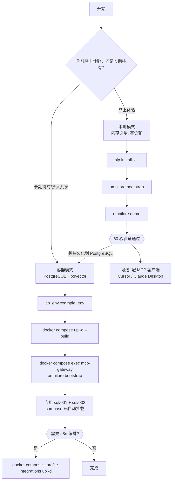

# OmniLore

**AI 原生可审计知识中枢** ｜ *One auditable knowledge base, for every agent.*

> ## `v0.3.0-alpha`
>
> **预发布版本（alpha）——仅供评估、研究与贡献使用，请勿放入任何重要业务流程。**
> 内部代际代号 v2.3，PEP 440 机读版本号 `0.3.0a0`。
> 许可：**[Apache-2.0](LICENSE)** ｜ 决策记录：**[docs/DECISIONS.md](docs/DECISIONS.md)**
> 仓库：**[github.com/KillerMan12345/OmniLore](https://github.com/KillerMan12345/OmniLore)**

OmniLore 是一个以**不可变原始证据（SHA-256 CAS Assets）**为基础、以**可审阅的 Obsidian Markdown 知识页**为人类主要编辑界面、以 **PostgreSQL 15+（`pgvector` + `ltree`）** 提供命令级行级安全策略（RLS）、任务状态机、零停机版本控制与混合检索索引的知识中枢。

核心价值不是「把文件塞进向量库」，而是把分散资料变成**有来源、有状态、有版本、有权限、有纠错路径**的资产。

---

## 60 秒验证（零 API Key，三段命令）

**不需要任何云账号、不需要配置 API Key、不需要数据库。** 三条命令跑完，你就拥有了一个可用的知识库。

### 第 1 步：安装

```bash
git clone https://github.com/KillerMan12345/OmniLore.git && cd OmniLore

python -m venv .venv && source .venv/bin/activate   # Windows: .venv\Scripts\activate
pip install -e .                                    # 若无本地 Python 环境管理器，pip install -e . 亦可
```

> 已在本仓库目录下可跳过 clone，直接 `pip install -e .`。

### 第 2 步：引导（`bootstrap` —— 创建空间与 token）

```bash
omnilore bootstrap
```

预期输出（节选，token 每次随机）：

```text
====================================================================
OmniLore bootstrap 完成
====================================================================
  数据目录      : /home/you/OmniLore_Data
  默认空间      : sp_bootstrap_personal
  Owner user_id : 00000000-0000-4000-8000-000000000001
  检索模式      : keyword_only
  降级说明      : 未配置 DASHSCOPE_API_KEY，自动降级为本地 BM25/关键词检索（零密钥可用）

  Owner Token   : tok__UVvbCICPCl0YUXeblmqr7wFDwYDZfJdNmHDH01hOB0  （新签发）
  Token 已持久化: /home/you/OmniLore_Data/ops/bootstrap.json
                  请妥善保存该 token；MCP 客户端首参即为该 token。
```

### 第 3 步：投一份文档，再把它搜出来（`demo`）

```bash
omnilore demo
```

预期输出（节选）：

```text
====================================================================
OmniLore demo：投一份文档，再搜到它（零 API Key）
====================================================================
  数据目录  : /home/you/OmniLore_Data
  目标空间  : sp_bootstrap_personal
  检索模式  : keyword_only
  降级说明  : 未配置 DASHSCOPE_API_KEY，自动降级为本地 BM25/关键词检索（零密钥可用）

[1/3] 收录文档：omnilore_welcome_note.md
      任务状态      : COMMITTED
      结果文档 ID   : be62e0e5-cba1-4112-8427-89f43eea2b34
[2/3] 检索关键词：'60 秒验证清单'
      命中结果数    : 1
      retrieval_mode: keyword_only
      degraded_reason: 未配置 DASHSCOPE_API_KEY，向量召回不可用，已自动降级为本地 BM25 / 关键词（keyword_only）检索

      #1 score=1.0  《OmniLore 零密钥上手说明》 v1.0
          # OmniLore 零密钥上手说明 ## 核心摘要 # OmniLore 零密钥上手说明 OmniLore 是一个 AI 原生的可审计知识中枢。本次演示在**没有任何云 API Key**的情况下完成 收录与检索，说明：不配置 `DASH

[3/3] 结论
      ✅ 已成功检索到刚收录的文档 be62e0e5-cba1-4112-8427-89f43eea2b34，60 秒验证通过。

  提示：Obsidian 知识页位于 /home/you/OmniLore_Data/02_Vault/spaces/sp_bootstrap_personal/wiki
```

> 上面两段是**程序真实输出的抄录**，只有 3 处按运行环境替换：数据目录路径（此处写作
> `/home/you/OmniLore_Data`）、随机生成的 token、随机生成的 doc_id。其余每一行逐字一致。

**看到 `✅` 就说明一切正常。** 全部过程没有联网、没有 Key。

> CLI 两种调用方式等价：`omnilore bootstrap` 与 `python -m omnilore bootstrap`。

---

## 我该走哪条路？（容器模式 vs 本地模式）



纯文本版：

```text
本地模式（推荐先试）
  pip install -e .  ->  omnilore bootstrap  ->  omnilore demo
  数据: ./OmniLore_Data    引擎: 内存 RLSDatabaseEngine    外部依赖: 无
  代价: 进程重启后结构化状态清空（已收录的文件与知识页仍在磁盘上）

容器模式（长期持有）
  cp .env.example .env  ->  docker compose up -d --build  ->  容器内 omnilore bootstrap
  数据: PostgreSQL 16 + pgvector    引擎: 真实 SQL + RLS    外部依赖: Docker + 可选 API Key
  可选: docker compose --profile integrations up -d   # n8n 工作流编排
```

| 维度 | 本地模式 | 容器模式 |
|---|---|---|
| 首启耗时 | 秒级 | 分钟级（需拉镜像） |
| 外部服务 | 无 | Docker + PostgreSQL |
| 结构化数据持久化 | 否（进程生命周期） | 是 |
| RLS 策略执行方式 | 同构内存模拟 | 真实 PostgreSQL 策略 |
| 适用 | 评估、开发、跑 CI | 长期持有、多人/多端共享 |

---

## 降级与上报（重要）

OmniLore **不会因为缺少云 API Key、或者 Key 配错了而拒绝工作**。

`search_knowledge` 的返回值里，**检索**与**答案合成**是两个正交维度，各自独立上报：

| 字段 | 含义 |
|---|---|
| `retrieval_mode` | `hybrid`（向量+关键词）或 `keyword_only`（纯 BM25 / 关键词） |
| `degraded_reason` | **仅**描述检索是否降级；检索正常时为空串 |
| `synthesis_degraded` | 答案合成是否回退到本地确定性逻辑 |
| `synthesis_note` | 合成回退的原因；正常时为空串 |

之所以拆成两组字段：曾经把合成失败并进 `degraded_reason`，会出现
`retrieval_mode=hybrid` 却 `degraded_reason` 非空的**自相矛盾**组合，调用方没法再用
「`degraded_reason` 是否为空」判断检索能力。拆开后两个维度正交。

四种组合态：

| # | 场景 | `retrieval_mode` | `degraded_reason` | `synthesis_degraded` | 说明 |
|---|---|---|---|---|---|
| 1 | 未配置 `DASHSCOPE_API_KEY`（**默认**） | `keyword_only` | 非空 | `false` | 纯 BM25 / 关键词（CJK 二元组分词）；答案由本地确定性逻辑生成，这是**设计路径，不是故障** |
| 2 | 已配置且完全可用 | `hybrid` | 空串 | `false` | BM25 + 1024 维向量 + 代码符号混合检索 |
| 3 | 已配置但向量召回不可用（过期 / 额度耗尽 / 断网） | `keyword_only` | 非空 | 视合成是否也失败 | 本次请求降级为关键词，**不抛异常** |
| 4 | 向量召回正常、答案合成失败 | `hybrid` | **空串** | `true` | 检索能力未受损，只有合成回退；原因见 `synthesis_note` |

`DASHSCOPE_API_KEY` 是**完完全全的可选项**。降级与否一律如实上报，
**不会**把故障伪装成正常，也**不会**把内部 bug 伪装成供应商故障（后者会记 stderr）。

> 分词说明：本地关键词检索的分词策略与本地确定性嵌入保持一致（词串 + 滑动 CJK 二元组）。
> 若只做整词匹配，中文查询几乎无法命中，因此这里刻意采用二元组。

---

## 仓库目录结构

```text
omnilore/
├── LICENSE                                           # Apache-2.0 完整原文
├── NOTICE                                            # 归属、依赖与商标政策
├── CHANGELOG.md                                      # 变更日志
├── CONTRIBUTING.md                                   # 贡献指南（DCO + 六条贡献路径）
├── SECURITY.md                                       # 漏洞披露政策（Issue/PR 首响 ≤48h）
├── CODE_OF_CONDUCT.md                                # Contributor Covenant 风格行为准则
├── README.md                                         # 本文件
├── pyproject.toml                                    # 包配置与 CLI 入口（version = 0.3.0a0）
├── Dockerfile                                        # 容器镜像构建文件
├── docker-compose.yml                                # postgres + mcp-gateway（n8n 为可选 profile）
├── .env.example                                      # 环境变量模板（标注必填/可选）
├── .gitignore
├── .github/
│   ├── PULL_REQUEST_TEMPLATE.md                      # 含 DCO 勾选项
│   └── workflows/ci.yml                              # 离线 CI：3.11/3.12 × ubuntu/windows
├── docs/
│   ├── DECISIONS.md                                  # 五项拍板决策（License/版本/遥测/窗口/命名）
│   ├── OmniLore_PRD_Architecture_Final_v2.3.md      # PRD 与架构决策基线母本
│   ├── 01_Product_Requirements_Document_v2.3.md      # PRD 摘要版（FR-01~FR-19 + D-01~D-13）
│   ├── 02_Architecture_and_Engineering_Design_v2.3.md
│   ├── 03_User_Stories_and_Scenarios_v2.3.md
│   └── 04_Test_Plan_and_Verification_Report_v2.3.md
├── n8n/workflows/                                    # 可选集成：3 条可导入工作流
├── sql/
│   ├── 001_omnilore_schema_and_rls.sql              # 15 张表 + 角色 + RLS（仅 DDL）
│   └── 002_omnilore_bootstrap_seed.sql              # 新增：最小 space/成员/token 种子数据
├── omnilore/                                        # 核心 Python 源码包
│   ├── __init__.py                                   # 公共导出 + __version__
│   ├── cli.py                                        # 新增：omnilore CLI（bootstrap/demo/version）
│   ├── __main__.py                                   # 新增：python -m omnilore
│   ├── bootstrap.py                                  # 新增：零密钥引导（CLI 与 MCP 共用）
│   ├── textio.py                                     # 新增：跨平台规范 LF 文本 I/O
│   ├── engine.py                                     # 核心引擎（约 3200 行，贡献请看 CONTRIBUTING）
│   ├── pg_repository.py                              # asyncpg 参数化 SQL 仓储层
│   ├── dashscope_client.py                           # 百炼 HTTP 适配层
│   ├── parsers.py                                    # 多格式解析器（纯函数，好入手）
│   ├── ops_manager.py                                # 备份/恢复/索引重建/一致性对账
│   ├── daemons.py                                    # Outbox 恢复与 Obsidian 监听守护
│   ├── http_worker_api.py                            # 供 n8n 调用的内部 HTTP 网关
│   └── mcp_stdio_server.py                           # FastMCP JSON-RPC 2.0 Stdio 服务端
└── tests/                                            # 端到端验收测试，共 53 个用例（0 skip）
    ├── _platform_support.py                          # 新增：宿主能力探测（symlink → junction 回退）
    ├── test_omnilore_phase0_acceptance.py           # Phase 0/1 专项（安全/RLS/幂等/恢复/模型门禁）10 项
    ├── test_full_omnilore_suite.py                  # Phase 0~3 + Ops 综合验收 9 项
    └── test_w0_launch.py                             # W0 新增回归（引导/LF/版本/降级/合成正交/归因/权限/漂移/CLI/MCP 入口/文档宣称）34 项
```

---

## 跑测试

```bash
python -m unittest discover -s tests -p "test_*.py" -v
```

**53 个测试用例**，全部离线运行，不需要数据库或 API Key：

| 测试文件 | 数量 | 覆盖 |
|---|---|---|
| `test_omnilore_phase0_acceptance.py` | 10 项 | Phase 0/1 专项：安全、RLS、幂等、崩溃恢复、模型门禁 |
| `test_full_omnilore_suite.py` | 9 项 | Phase 0~3 + Ops 综合验收 |
| `test_w0_launch.py` | 34 项 | **W0 新增**：引导幂等与 token 复用、LF 规范化、版本号一致、零 Key 降级、供应商故障降级、CLI/MCP 路径解析一致、CLI 端到端、MCP stdio 入口握手、`OMNILORE_AUTO_BOOTSTRAP=0` 不废既有 token |

> **关于符号链接断言（已做到 0 skip）**：AC-S05 需要构造一个指向 Vault 之外的链接，
> 但很多 Windows 环境没有创建符号链接的特权。我们按能力**逐级回退**：
> ① 真实 **symlink**（Linux / macOS / 开了开发者模式的 Windows）；
> ② **目录联接 junction**（`mklink /J`，Windows 上**无需特权**）——它不是 symlink，
> 但 `Path.resolve()` 会穿透它，因此仍会被 `SecureVaultStorage._verify_safe_subpath`
> 的「越出根目录边界」检查拦下，是真实验证而非桩；
> ③ 两者都造不出来时才 **skip**，并给出可复核的原因（宿主能力限制，非平台缺陷）。
>
> 目前在 Linux / macOS / Windows 三平台上，这 2 条断言都是**真实执行**的，
> **默认 0 skip**。我们刻意不使用静默 `try/except` 去掩盖 ——
> 详见 `tests/_platform_support.py`。

---

## 核心能力

### Phase 0 — 安全基座

- 每次请求强制计算四维交集：`Token 范围 ∩ 当前有效 Membership ∩ 空间继承规则 ∩ Profile/Category 规则`。
- `WORK` Profile 硬性隔离同一空间下的 `02_Life` / `03_Family` / `04_Health_Archive`；
  `FAMILY` Profile 硬性隔离个人私库与企业空间。
- Token 撤销与成员移除立即触发进程内缓存主动失效（实测 `< 1ms`，满足 `≤ 5s` SLO）。
- 文件网关拒绝绝对路径、`..`/`.` 段与符号链接；只接受受控的 `space_id/wiki/...` 相对路径。

### Phase 1 — 入库、版本、检索

- 多格式入库：Markdown、代码、PDF（`pdfplumber`/`pypdf` 提取页码与表格）、图像（`Pillow`）。
- AST 代码符号提取：类名、方法名、REST 路由、`ADR-xxx`，支持按 `code_symbol` 过滤。
- 两阶段零停机版本控制：新建 / `REPLACE_VERSION` / `SUPPLEMENT_DOC` / `REVERT_VERSION`。
- 全部 7 个审核动作：`APPROVE_REVIEW`、`RECLASSIFY`、`SPLIT_DOCUMENT`、`FIX_EXTRACTED_FIELD`、
  `REVERT_VERSION`、`PROMOTE_COPY`（含脱敏预览）、`CANCEL_TASK`。
- Obsidian 双向同步：写回哈希比对防死循环、受保护 Frontmatter 字段防篡改、
  `.conflict_r*.md` 冲突副本、自动生成 `_dashboard_控制台.md`。

### Phase 2 — 家庭与健康

- 家庭空间 `ADMIN` 邀请/更新/撤销成员。
- 体检指标自动提取并默认标记 `NEEDS_CHECK`（附「AI 提取，尚未核验」提示），
  经人工 `FIX_EXTRACTED_FIELD` 复核后转为 `HUMAN_VERIFIED`。
- `run_knowledge_lint` 巡检过期 TTL、悬空 `[[双链]]` 与未核验指标 —— **只出建议，不静默改写**。

### Phase 3 — 企业组织树

- 沿 `parent_space_id` 与 `ltree`（`org.eng.backend` → `org.eng` → `org`）自动继承
  上级 `ORG_PUBLIC` 空间**只读**权限；写权限绝不继承，`ORG_RESTRICTED` 不参与继承。
- 跨空间晋升时自动扫描并脱敏身份证号、手机号、银行卡号与 `sk-`/`tok-`/`ak-` 密钥。

### Section 12 — 运维

- SHA-256 manifest 快照备份、恢复前逐文件校验、跨版本蓝绿向量索引重建、
  磁盘与数据库一致性对账（`reconcile_consistency`）。

> 完整功能矩阵 `FR-01`~`FR-19` 与决议 `D-01`~`D-13` 见
> [`docs/01_Product_Requirements_Document_v2.3.md`](docs/01_Product_Requirements_Document_v2.3.md)。

---

## MCP 客户端接入

7 个 MCP 工具通过标准 JSON-RPC 2.0 stdio 暴露。`omnilore bootstrap` 会打印一份
可直接粘贴的配置；模板如下（`DASHSCOPE_API_KEY` 为**可选**项）：

```json
{
  "mcpServers": {
    "omnilore": {
      "command": "omnilore-mcp",
      "env": {
        "OMNILORE_DATA_DIR": "/path/to/OmniLore_Data",
        "OMNILORE_BOOTSTRAP_TOKEN": "<bootstrap 输出的 token>",
        "DASHSCOPE_API_KEY": ""
      }
    }
  }
}
```

也可以直接用 Python 模块方式启动：

```json
{ "command": "python3", "args": ["-m", "omnilore.mcp_stdio_server"], "env": { "OMNILORE_DATA_DIR": "/path/to/OmniLore_Data" } }
```

暴露的工具：`search_knowledge`、`get_document_asset`、`ingest_document_or_file`、
`commit_memory_note`、`get_ingestion_task`、`review_and_fix_knowledge`、`query_health_trends`。
每个工具首参均为 `token` —— 由 `omnilore bootstrap` 签发。

相关环境变量：

| 变量 | 必填 | 说明 |
|---|---|---|
| `OMNILORE_DATA_DIR` | 推荐 | 数据目录，默认 `./OmniLore_Data` |
| `OMNILORE_BOOTSTRAP_TOKEN` | 可选 | 显式指定 owner token |
| `OMNILORE_AUTO_BOOTSTRAP` | 可选 | `0` 关闭**自动创建**（默认开）。只影响「尚无身份时是否新建」；已存在的 `ops/bootstrap.json` 仍会被加载，既有 token 不受影响 |
| `DASHSCOPE_API_KEY` | **可选** | 留空即降级为关键词检索 |
| `DATABASE_URL` | 容器模式必填 | PostgreSQL 连接串 |
| `OMNILORE_TELEMETRY` | 可选 | 遥测开关，默认 `0`（本版本尚未实现遥测） |

---

## 文档导航

| 文档 | 适合谁 |
|---|---|
| [`docs/01_Product_Requirements_Document_v2.3.md`](docs/01_Product_Requirements_Document_v2.3.md) | 想快速了解需求范围：`FR-01`~`FR-19` 矩阵与已锁定决议 |
| [`docs/02_Architecture_and_Engineering_Design_v2.3.md`](docs/02_Architecture_and_Engineering_Design_v2.3.md) | 后端/安全：权限交集、`(space_id, category)` RLS、15 张表、Saga、同步协议 |
| [`docs/03_User_Stories_and_Scenarios_v2.3.md`](docs/03_User_Stories_and_Scenarios_v2.3.md) | 角色化的用户故事与 `Given/When/Then` 验收标准 |
| [`docs/04_Test_Plan_and_Verification_Report_v2.3.md`](docs/04_Test_Plan_and_Verification_Report_v2.3.md) | QA/审计：追踪矩阵与**内存仿真的边界** |
| [`docs/DECISIONS.md`](docs/DECISIONS.md) | 想了解许可证、版本、遥测、排期四项拍板 |
| [`CHANGELOG.md`](CHANGELOG.md) | 每次版本变更了什么 |

---

## 参与贡献

贡献动机不必从读懂约 3200 行的 `engine.py` 开始 —— **六条贡献路径全都绕开了核心文件**
（SQL 迁移、n8n 工作流、解析器纯函数、测试用例、文档、CLI 体验）。

```bash
git commit -s -m "fix(storage): ..."   # -s 追加 DCO Signed-off-by，必填
```

详见 [`CONTRIBUTING.md`](CONTRIBUTING.md) 与 [`SECURITY.md`](SECURITY.md)
（Issue 首响 ≤48h，PR 首响 ≤48h）。

---

## 已知限制（诚实披露）

1. **默认数据库是内存引擎。** 与 PostgreSQL RLS 策略同构，但进程退出后结构化状态清空；
   磁盘上的原始资产与 Markdown 知识页会保留。长期持有请走容器模式。
2. **符号链接断言依赖宿主能力**：优先用真实 symlink，Windows 无特权时回退到目录联接
   （junction）。若宿主两者都造不出来，2 条 AC-S05 断言会被显式 skip —— 那是宿主能力
   限制，非平台缺陷（当前主流平台均已做到 0 skip）。
3. **向量召回依赖外部供应商。** 零 Key 时降级为关键词检索，语义能力下降，但不会失败。
4. **遥测尚未实现。** 决策已接受 opt-in 匿名遥测，实现排期在 Q2（见 `docs/DECISIONS.md`）。
5. **`engine.py` 的架构级重构排期在 Q2 之后**，本期刻意不做（最小变更原则）。

---

## 许可证与商标

- 代码：**[Apache-2.0](LICENSE)**（完整原文，未作任何修改）。
- 贡献：需签署 **DCO**（`git commit -s`）。
- 商标：`OmniLore` 名称与标识**不在** Apache-2.0 授权范围内，详见 [`NOTICE`](NOTICE)。
